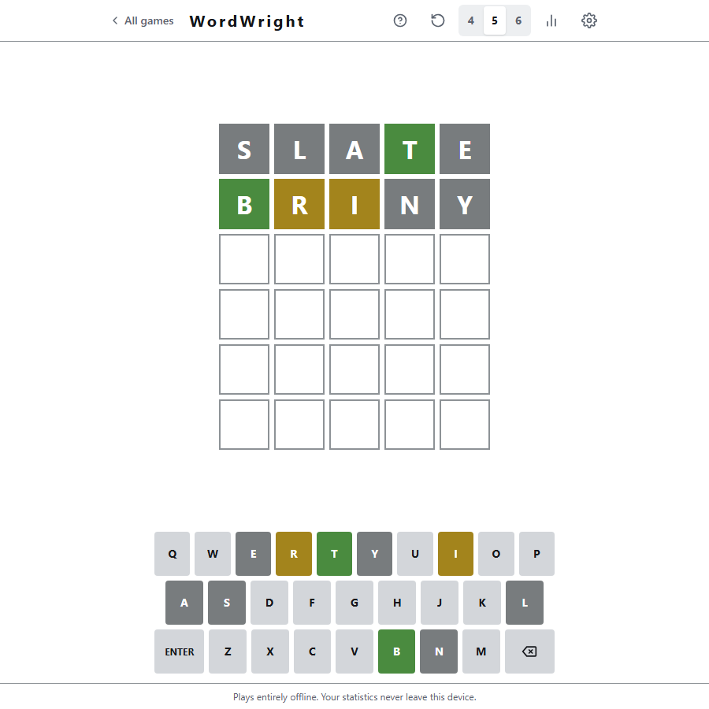
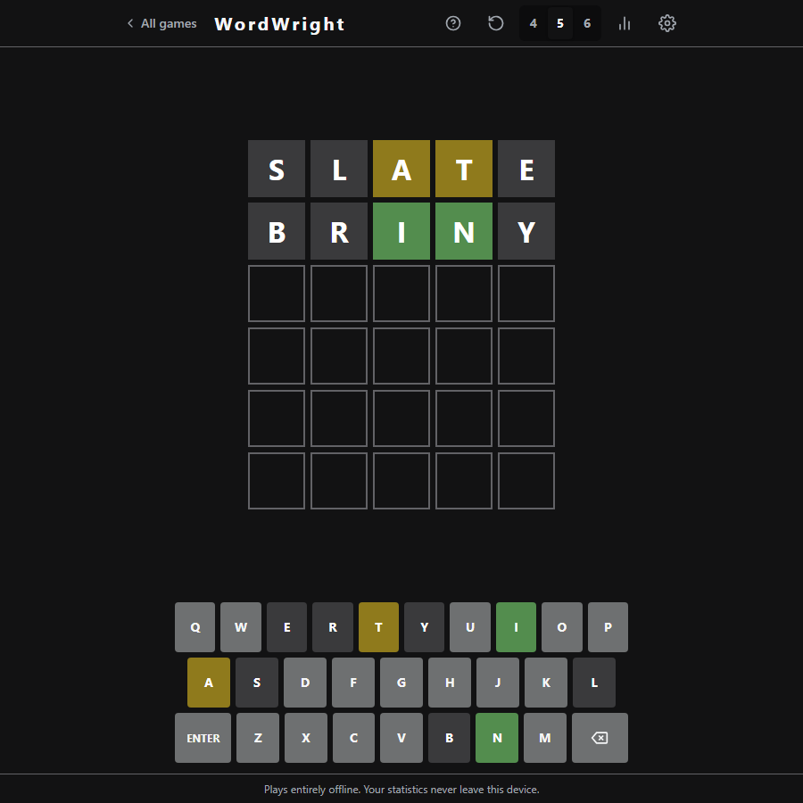
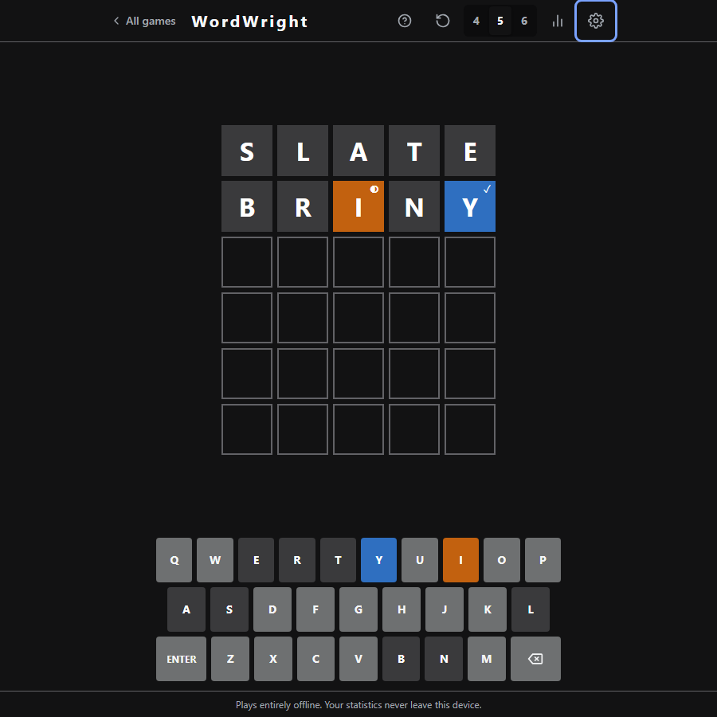
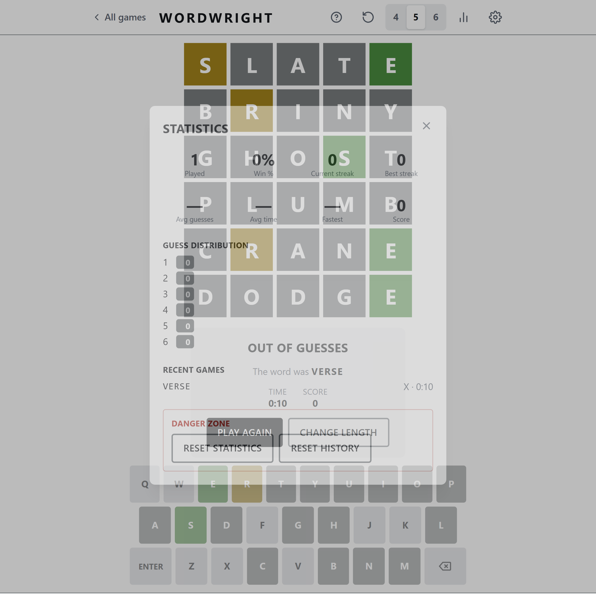
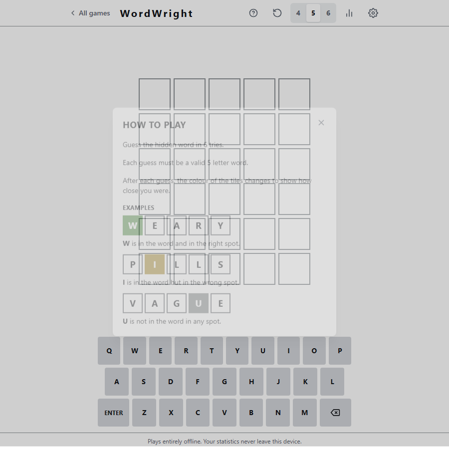

# WordGames

An offline suite of word games. **WordWright** is a Wordle-style game for 4, 5 and 6 letters. **WordWeaver** is a word ladder: change one letter at a time to get from one word to another. **WordStack** plays Wordle on two or four boards at once. **WordRange** finds a word by narrowing an alphabetical range. **WordCode** gives only bull and cow counts. **WordShuffle** unscrambles a word. **WordDodge** is a Wordle that never picks a word. **WordHunt** finds every word hiding in six letters. **WordHang** is Hangman. No backend, no accounts, no network calls. Everything runs in the browser and persists to LocalStorage.

> **Status:** All nine games are built, 103 of 103 tasks: WordWright, WordWeaver, WordStack, WordRange, WordCode, WordShuffle, WordDodge, WordHunt and WordHang. 2,490 unit and integration tests and the Playwright browser tests pass, with axe scans of every game in both themes and both palettes. See [`docs/TASKS.md`](./docs/TASKS.md) and [`docs/ACCEPTANCE.md`](./docs/ACCEPTANCE.md).

---

## Table of Contents

- [Overview](#overview)
- [Features](#features)
- [Tech Stack](#tech-stack)
- [Getting Started](#getting-started)
- [Development Workflow](#development-workflow)
- [Project Structure](#project-structure)
- [Documentation Map](#documentation-map)
- [Roadmap](#roadmap)
- [License](#license)

---

## Overview

WordGames is a single-page web app with a Home screen and one view per game, chosen by the URL hash (`#/`, `#/wordwright`, `#/weaver`, `#/stack`, `#/range`, `#/code`, `#/shuffle`, `#/dodge`, `#/hunt`, `#/hang`). Wordwright recreates the Wordle game loop with three word lengths, unlimited replays, and a full statistics suite. WordWeaver generates an unlimited supply of ladder puzzles on the device, scored against par. Each game keeps its own statistics, preferences and saved game. The suite is deliberately **local-first**: the dictionaries ship with the bundle, game state and stats live in LocalStorage, and the app is fully playable with the network disabled.

**Design principles**

1. **KISS over abstraction.** Build the simplest thing that satisfies the spec. Add indirection only where V2 demands it.
2. **Framework-independent engine.** All game rules live in pure TypeScript with zero React imports, so they are trivially testable and reusable.
3. **Accessibility is a requirement, not a polish item.** Screen reader parity, keyboard-only play, colorblind-safe palette, reduced-motion support.
4. **Offline by construction.** No `fetch`, no runtime CDN, no telemetry.

---

## Screenshots

| Light                                                     | Dark                                                    |
| --------------------------------------------------------- | ------------------------------------------------------- |
|  |  |

| Colourblind palette                                                                                                    | Statistics                                                                                                  |
| ---------------------------------------------------------------------------------------------------------------------- | ----------------------------------------------------------------------------------------------------------- |
|  |  |

| How to play                                                                                       |
| ------------------------------------------------------------------------------------------------- |
|  |

Colourblind mode swaps green/yellow for blue/orange **and** adds distinct tile markers, so colour is never the only signal. Screenshots are generated from the production build by `npm run screenshots`.

## Features

### Home and navigation

- A Home screen with one card per game, and an **All games** link in every game
- Hash routes with working Back, Forward and bookmarks; the page title and focus follow the view
- Leaving a game keeps it: coming back restores the board, the typed letters and the move count
- **Enter** on a result screen starts the next game, in every game
- Returning WordWright players keep their statistics, streaks, settings and game in progress: the app copies the old `wordwright:v1:*` data across once and never deletes it

### WordWeaver

- Get from a start word to an end word, one letter per rung; every rung must be a real word
- Letters that already match the end word turn green; there is no yellow
- 4 or 5 letters (default 4), unlimited puzzles generated on the device, no daily or shared puzzles
- **Par** is the shortest ladder made of everyday words. A rarer word can finish **under par**. Par and your move count show above the ladder
- **Undo** (or Backspace on an empty row), **Give up** (shows one shortest ladder) and **New puzzle**
- Statistics overall and per length: solved, gave up, par hits, average over par, best vs par and streaks

### WordStack

- Solve 2 boards (**Duo**, 7 guesses) or 4 boards (**Quad**, 9 guesses) at the same time; every guess plays on every open board
- Each board has its own hidden word and its own colours; a solved board freezes
- A split keyboard: each key shows one segment per board, with markers so colour is never the only cue
- Statistics overall and per mode, with a guess distribution for each

### WordRange

- Find a hidden 4, 5 or 6-letter word in 13, 14 or 15 guesses. Each guess tells you whether the word comes **before** or **after** it in the dictionary
- The **range** shows the two words you have narrowed it to, and only words inside it are allowed
- **Heat** (Burning, Hot, Warm, Cold, Freezing) says how near a guess is, always written as a word
- Statistics overall and per length, with a guess distribution for each

### WordCode

- Find the hidden word from counts only: **bulls** are letters in the right place, **cows** are letters in the word but misplaced
- 4, 5 or 6 letters, 10 guesses, and no tile colours
- **Letter notes**: switch the keyboard to **Mark** and tap a letter to cycle it through unmarked, ruled out and in the word. Marks show on the keys and are saved with the game
- Statistics overall and per length

### WordShuffle

- The letters of a word arrive shuffled in a tray. Type or tap them into order
- **Any real word** that uses exactly those letters wins, not only the drawn one
- Up to 2 **hints** lock the next letter of the drawn word in place; **Reshuffle** is free; **Give up** shows every valid anagram
- 4, 5 or 6 letters and no guess limit. Targets are less common words than the answers of the other games, no letter starts where it belongs, and a count-up clock shows how long you took

### WordDodge

- A Wordle that never picks a word. Each guess is answered with the colours that keep the **most** words possible, so you cut the list down rather than guess it
- A count shows how many words are left. You win by guessing the last one. There is no guess limit
- 4, 5 or 6 letters. **Give up** shows a word that was still possible and counts as a loss
- Statistics overall and per length, with wins grouped by guesses used

### WordHunt

- Six letters sit in a tray. Find every common word of 4, 5 or 6 letters that can be made from them
- Slots grouped by length show how many are left. A found word fills its slot, and a count-up clock shows how long you took
- Any other real word is a **bonus word**: it is counted but never needed. **Reshuffle** is free; **Give up** shows the words you missed
- Statistics for completion, the share of words found, bonus words and times

### WordHang

- Hangman: guess the hidden word one letter at a time. A letter in the word shows in every place it appears
- Each wrong letter draws one more part of the figure, and the sixth loses. A letter you have tried cannot be pressed again, and a repeat costs nothing
- 4, 5 or 6 letters. Statistics overall and per length, with wins grouped by misses

### WordWright

- 4, 5, and 6 letter modes — 6 guesses in every mode
- Unlimited games with random answer selection (no repeats until the pool cycles)
- Exact Wordle evaluation semantics, including correct duplicate-letter handling
- Guess validation against a large allowed-guess dictionary, separate from the curated answer list
- Win/loss detection, in-progress game resumption after refresh

### Experience

- Built-in **How to play** guide with worked tile examples for every word length
- Responsive layout from 320 px phones to widescreen desktops
- Physical keyboard **and** on-screen keyboard, kept in sync
- Tile flip reveal, key press/state animations, shake on invalid input, win bounce
- Loading states for dictionary chunks, non-blocking error toasts
- **New game** at any time, and switch word length at any time, each with a confirmation once a guess has been made

### Statistics (LocalStorage)

Games played · games won · win % · current streak · best streak · average guesses · guess distribution · total score · average solve time · fastest solve · recent games log

### Settings

Light / Dark / System theme · colorblind-friendly palette · reduced motion override. These apply to every game. Each game's Statistics dialog has its own **Reset statistics** and **Reset history**.

### Accessibility

Full keyboard navigation · ARIA grid semantics and live announcements · visible focus rings · WCAG AA contrast · `prefers-reduced-motion` and `prefers-color-scheme` honoured

---

## Tech Stack

| Concern       | Choice                                           | Pinned     |
| ------------- | ------------------------------------------------ | ---------- |
| UI            | React (function components + hooks)              | 19.2       |
| Language      | TypeScript (strict)                              | 6.0        |
| Build         | Vite                                             | 8.1        |
| Styling       | Tailwind CSS (CSS-first `@theme` tokens)         | 4.3        |
| Tests         | Vitest + React Testing Library + jsdom           | 4.1        |
| Lint / Format | ESLint (flat config) + Prettier                  | 9.39 / 3.9 |
| State         | React Context + `useReducer` (no external store) | —          |
| Persistence   | LocalStorage behind a versioned repository layer | —          |

TypeScript is held at 6.x and ESLint at 9.x so that type-aware linting and `eslint-plugin-jsx-a11y` both keep working; the reasoning and the upgrade trigger are recorded in [ADR-015](./docs/DECISIONS.md#adr-015--toolchain-version-pins-typescript-6-eslint-9).

No backend. No authentication. No APIs. No database.

---

## Getting Started

### Prerequisites

- Node.js **>= 20.19** (Vite 7 requirement)
- npm **>= 10**

### Install & run

```bash
git clone <repo-url> wordgames
cd wordgames
npm install
npm run dev        # http://localhost:5173
```

### Build & preview

```bash
npm run build      # type-check + production bundle into dist/
npm run preview    # serve dist/ locally
```

To verify the offline promise: run `npm run preview`, load the page, then disable networking in DevTools and keep playing.

---

## Development Workflow

| Command                      | Purpose                                                         |
| ---------------------------- | --------------------------------------------------------------- |
| `npm run dev`                | Vite dev server with HMR                                        |
| `npm run build`              | `tsc -b` then `vite build`                                      |
| `npm run preview`            | Serve the production build                                      |
| `npm run test`               | Vitest in watch mode                                            |
| `npm run test:run`           | Single CI-style test pass                                       |
| `npm run test:coverage`      | Coverage report (thresholds enforced)                           |
| `npm run test:e2e`           | Playwright browser tests (axe, layout)                          |
| `npm run build:dictionaries` | Regenerate the word lists (offline once the sources are cached) |
| `npm run lint`               | ESLint over `src/`                                              |
| `npm run lint:fix`           | ESLint with `--fix`                                             |
| `npm run format`             | Prettier write                                                  |
| `npm run format:check`       | Prettier check (CI)                                             |
| `npm run typecheck`          | `tsc --noEmit`                                                  |
| `npm run verify`             | typecheck + lint + format:check + test:run                      |

**Loop:** write a failing test → implement → `npm run verify` → commit with a [Conventional Commit](./docs/CONTRIBUTING.md#commit-conventions) message.

The architecture is also enforced by ESLint, so a violation fails the build rather than waiting for review:

| Rule                                                            | Enforces                                   |
| --------------------------------------------------------------- | ------------------------------------------ |
| No `react` / DOM / storage imports in `src/engine/**`           | ADR-003 — framework-independent engine     |
| No `Math.random()` / `Date.now()` in `src/engine/**`            | ADR-009 — injected randomness and clock    |
| No raw colour utilities (`bg-green-500`) in `src/components/**` | ADR-008 — semantic design tokens           |
| No `localStorage` outside `src/storage/**`                      | NFR-11 — persistence only via repositories |
| 100% branch coverage for `src/engine/**`                        | NFR-8                                      |

Engine work is test-first. UI work is spec-first. See [`docs/TASKS.md`](./docs/TASKS.md) for the ordered backlog.

---

## Project Structure

```
wordgames/
├── docs/                  # Specification set (source of truth)
├── public/                # Static assets served as-is
├── src/
│   ├── engine/            # Pure game rules — no React, no DOM
│   │   ├── weaver/        # WordWeaver: ladder graph, shortest paths, generation, reducer
│   │   ├── stack/         # WordStack: boards, per-board scoring, answers
│   │   ├── range/         # WordRange: range, heat by list distance
│   │   ├── code/          # WordCode: bulls and cows, letter notes
│   │   ├── shuffle/       # WordShuffle: anagram index, scramble, tray and hints
│   │   ├── dodge/         # WordDodge: the adversary, candidates and replay on restore
│   │   ├── hunt/          # WordHunt: words hiding in a tray, the puzzle pool and the check
│   │   └── hang/          # WordHang: letters tried, misses and the figure
│   ├── dictionary/        # Word lists (answers, guesses, ladder) + lazy loading registry
│   ├── shell/             # Home, hash routing, the frame around every view
│   ├── storage/           # LocalStorage repositories, legacy import
│   ├── state/             # React providers wrapping the engines (one folder per game, such as state/stack/)
│   ├── components/        # Presentational + container components
│   ├── hooks/             # Reusable React hooks
│   ├── lib/               # Small shared utilities
│   ├── styles/            # Tailwind entry + design tokens
│   └── test/              # Test setup and shared fixtures
└── <tooling configs>
```

Full breakdown in [`docs/ARCHITECTURE.md`](./docs/ARCHITECTURE.md).

---

## Documentation Map

| Document                                         | What it answers                                                                                                         |
| ------------------------------------------------ | ----------------------------------------------------------------------------------------------------------------------- |
| [`docs/SPEC.md`](./docs/SPEC.md)                 | **What** we are building — PRD, user stories, functional & non-functional requirements, edge cases, acceptance criteria |
| [`docs/ARCHITECTURE.md`](./docs/ARCHITECTURE.md) | **How** it is built — folders, components, state, data flow, storage, engine design, extension points                   |
| [`docs/TASKS.md`](./docs/TASKS.md)               | **In what order** — phased, independently completable tasks                                                             |
| [`docs/CONTRIBUTING.md`](./docs/CONTRIBUTING.md) | **Working agreements** — coding standards, git & commit conventions, PR checklist                                       |
| [`docs/ACCEPTANCE.md`](./docs/ACCEPTANCE.md)     | **Definition of Done** — the final validation checklist                                                                 |
| [`docs/DECISIONS.md`](./docs/DECISIONS.md)       | **Why** — ADR-style records for every significant choice                                                                |

Read `SPEC.md` first. When code and docs disagree, the docs win — or the docs get updated in the same PR.

---

## Roadmap

**Suite V1 and releases R2 to R8**
Home and navigation, WordWright, WordWeaver, the rename to wordgames with no loss of saved data, then WordStack, WordRange, WordCode, WordShuffle, WordDodge, WordHunt and WordHang. Nothing else is planned: Appendix A of the SPEC lists game ideas that are deliberately not built.

**V2 — Gameplay expansion (not implemented; architecture must not block it)**
Daily challenge · hard mode · practice mode · timed mode · survival mode · custom & seeded games · shareable links · calendar heatmap · long-term trends · per-length analytics · win history charts · sound effects · richer animations · themes · confetti · achievements · installable PWA with offline caching.

**V3 — Community & advanced (explicitly out of scope)**
Accounts · cloud sync · multiplayer · leaderboards · friend challenges · multiple languages · community dictionaries · daily events · seasonal themes · tournament / endless / co-op / race modes.

The V2 and V3 lists exist to steer architecture — see the _Extension Points_ section of [`docs/ARCHITECTURE.md`](./docs/ARCHITECTURE.md). **Do not implement them in V1.**

---

## License

MIT. Word lists are derived from public-domain and permissively licensed sources; see `src/dictionary/data/README.md` for provenance.

---

## Moving from the old address

The project was renamed from Wordwright to wordgames, and the site now lives at `/wordgames/`. These steps are for the repository owner and are not part of any code change:

1. Rename the GitHub repository to `wordgames`, and update the Pages settings if the source changed.
2. Update the local remote: `git remote set-url origin <new-url>`.
3. Keep old bookmarks working: create a small repository named `wordwright` whose Pages site redirects to the new address. Its whole content is one `index.html`:

```html
<!doctype html>
<html lang="en">
  <head>
    <meta charset="UTF-8" />
    <meta http-equiv="refresh" content="0; url=/wordgames/" />
    <link rel="canonical" href="/wordgames/" />
    <title>Moved to wordgames</title>
  </head>
  <body>
    <p>This game has moved. <a href="/wordgames/">Go to wordgames</a>.</p>
  </body>
</html>
```

Returning players lose nothing. On GitHub Pages the old and new addresses share one origin (`username.github.io`), so LocalStorage is shared, and the first load of the new address copies the saved data across (SPEC FR-69).
